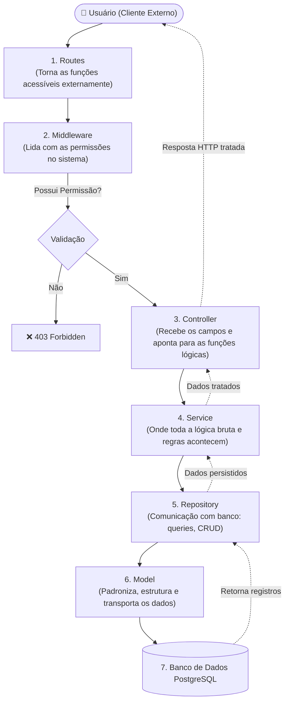
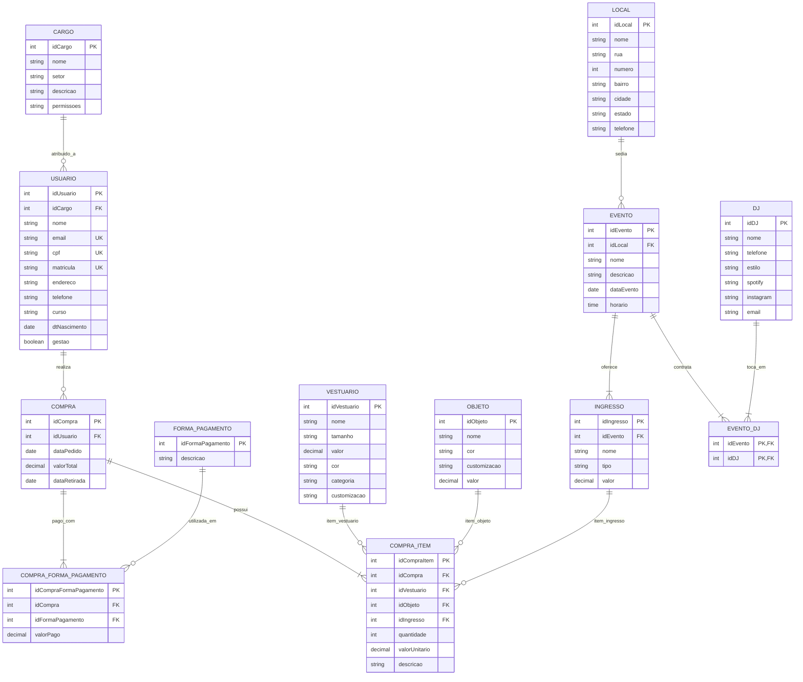
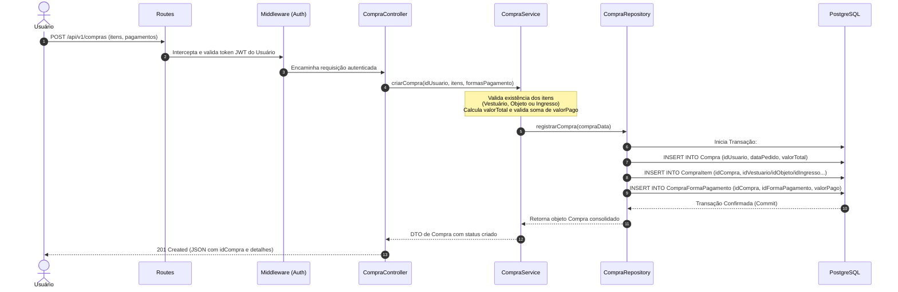
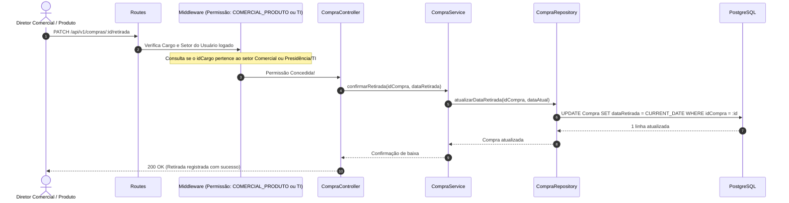

# DESIGN — Arquitetura e Engenharia de Sistema
## AAACA (Associação Atlética Acadêmica Campus Araranguá — UFSC)

---

| Metadado | Detalhe |
| :--- | :--- |
| **Projeto** | Sistema de E-commerce, Gestão de Sócios, Estoque e Vendas (AAACA) |
| **Documento** | Architecture & System Design Document (`DESIGN.md`) |
| **Modelos de Origem** | `logico_corrigido.sql`, `Fluxo_Arquitetura_Backend_Sistema_AAACA.brM3`, `Conceitual.brM3` |
| **Padrão Arquitetural** | Backend em Camadas com Middleware de Permissões + Banco Relacional PostgreSQL |
| **Versão** | 2.0.0 (Congelado) |

---

## 1. Visão Geral da Arquitetura do Backend

O fluxo de processamento de requisições no backend do sistema segue a modelagem formal de arquitetura definida no diagrama **`Fluxo_Arquitetura_Backend_Sistema_AAACA.brM3`**:



### Especificação de Responsabilidades das Camadas:

| Camada | Função Oficial no Projeto |
| :--- | :--- |
| **`Routes`** | Faz com que as funções dentro do sistema sejam acessíveis pelo usuário em ambientes externos através dos métodos HTTP (GET, POST, PUT, DELETE, PATCH). |
| **`MiddleWare`** | Camada específica responsável por lidar com as permissões dentro do sistema. Inspeciona o cargo e o setor do usuário autenticado: caso possua a devida permissão, o fluxo segue adiante; caso contrário, a requisição é interceptada. |
| **`Controller`** | Responsável por receber os campos de informação da requisição (body, params, query) e apontar para as funções lógicas no Service, recebendo de volta os dados tratados para montar a resposta HTTP. Não contém regras de negócio. |
| **`Service`** | Onde toda a lógica bruta acontece. Executa validações de regras de negócio, cálculos de valores, composição de compras, restrições e orquestração de operações. Não realiza requisições HTTP nem lida com objetos `req`/`res`. |
| **`Repository`** | Onde toda a comunicação com o banco de dados é desenvolvida. Concentra as queries SQL e métodos de CRUD (CREATE, READ, UPDATE, DELETE). Apenas recebe dados e joga para o banco de dados ou retorna os dados de dentro dele. Não realiza chamadas HTTP. |
| **`Model`** | Mantém estruturados e padronizados todos os dados. Dita como os dados são organizados e mapeados para as tabelas do PostgreSQL. Não realiza validações complexas nem chamadas HTTP. |
| **`Banco de Dados`** | Sistema Gerenciador de Banco de Dados Relacional (PostgreSQL), executando o esquema físico gerado pelo script DDL. |

---

## 2. Diagrama Entidade-Relacionamento (ERD Oficial)

Este diagrama reflete com fidelidade de 100% o modelo de dados definido em **`logico_corrigido.sql`**:



---

## 3. Fluxos de Negócio e Sequência

### 3.1 Fluxo de Realização de Compra (Checkout de Múltiplos Itens)



### 3.2 Fluxo de Entrega e Retirada Presencial (`dataRetirada`)



---

## 4. Arquitetura de Permissões por Setor e Cargo

A validação de permissões é realizada pela camada de **`MiddleWare`**:

1. Ao efetuar login, o sistema busca o registro em **`Usuario`** e seu respectivo **`Cargo`**.
2. O payload do token JWT contém:
   ```json
   {
     "idUsuario": 10,
     "nome": "Lucas Silveira",
     "gestao": true,
     "idCargo": 2,
     "setor": "COMERCIAL_PRODUTO",
     "permissoes": "PRODUTOS_WRITE,EVENTOS_WRITE,RETIRADA_WRITE"
   }
   ```
3. O middleware avalia a restrição de rota:
   ```typescript
   // Exemplo de aplicação na camada Routes:
   router.post(
     '/vestuarios',
     ensureAuthenticated,
     ensureSector(['COMERCIAL_PRODUTO', 'PRESIDENCIA', 'TI']),
     vestuarioController.create
   );
   ```

Se o usuário for aluno comum (`gestao = false`, `idCargo = null`), qualquer tentativa de acesso administrativo é rejeitada no Middleware com HTTP `403 Forbidden`.
